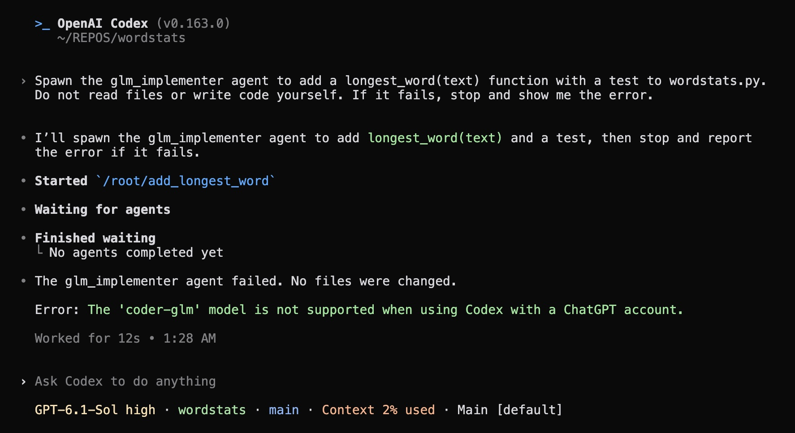
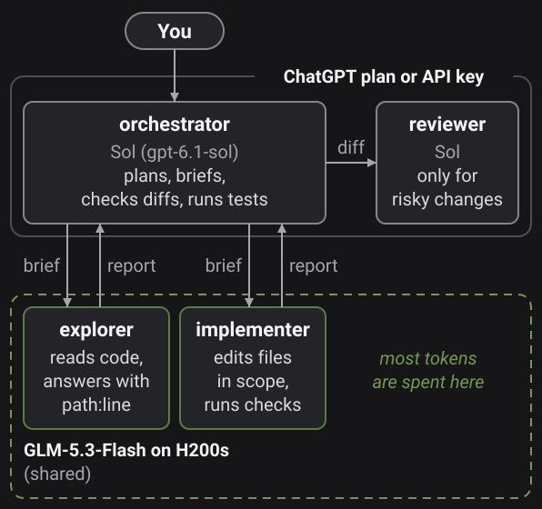
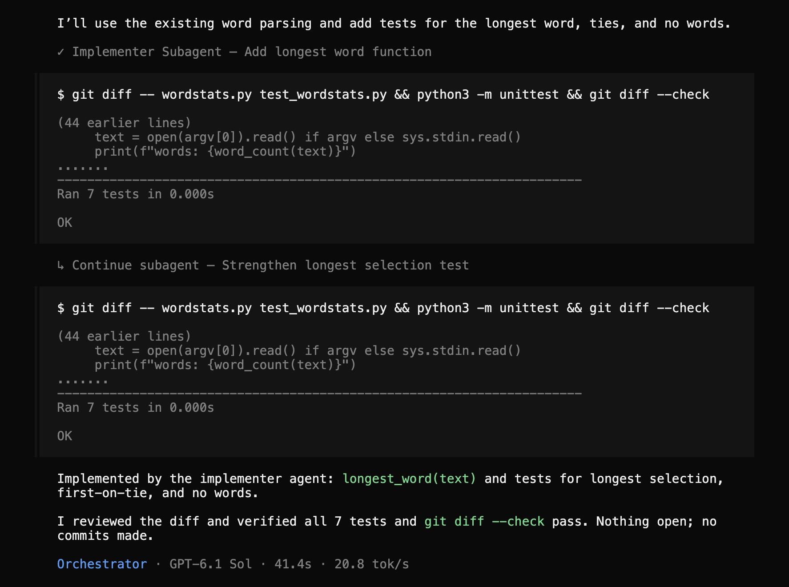
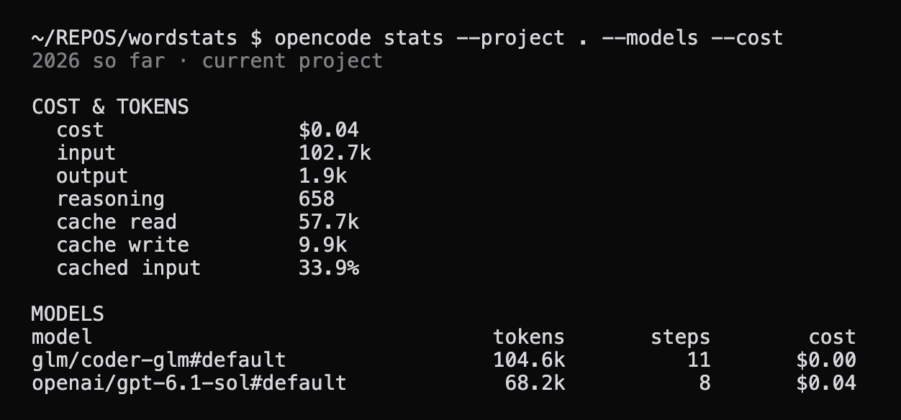

In my current job we have quite a few H200 GPU servers :). A couple of weeks back I deployed `GLM-5.3-Flash` on one of them with the aim of making it my main coding model and the workhorse for development so that I can cut down my Claude Code and Codex usage. If that works, I can even nudge my teammates to use it as well 🙈.

No doubt models like Claude Opus 5.5, GPT-6 Astra or GPT-6.1 Sol are the best right now and way ahead of their open-source counterparts for complex tasks. However, no one can ignore the \$\$ of using them and the anxiety of hitting the limits or draining your credits. 

`GLM-5.3-Flash` is free, runs on a single 4-GPU H200 server and is good enough for low and medium complexity tasks. It is also quite fast since it is an MoE model (320B total, only 18B active). I serve it with a 512K context window and if needed I can scale it to around 8 to 10 people at the same time without any issues.

Based on my experience, I would not ideally switch to it for all tasks but it pairs really well with Sol (or maybe Opus 5.5). Instead of running the whole session with one model, Sol does the planning, writes the briefs, reads the diffs and runs the checks, while GLM reads the code, makes the edits, runs the tests and iterates on failures. Sol also catches things GLM misses. This way the plan limits (or the API bill) go to judgment and most of the tokens go to in-house GPUs.

> Nothing here depends on GLM. You can deploy this model or any other one, even something like [Qwen3.8-27B](https://huggingface.co/Qwen/Qwen3.8-27B) on [a single GPU](https://aayushgarg.dev/posts/2026-03-29-local-llm-opencode/index.html).

## Which harness to use

Ideally I would love to use this pattern in Claude Code or Codex since I am more used to them and both have a great harness. But I found it is not easy (or maybe not even possible) to have the main session running on Sol or Opus 5.5 while the subagents do all the work on your locally deployed model, in this case `GLM-5.3-Flash`.

For example in Codex I set up a `glm_implementer` agent role pointing at the GLM server. Codex picks up the role but still sends its requests to OpenAI so the subagent fails right away with `The 'coder-glm' model is not supported when using Codex with a ChatGPT account.`



This turns out to be documented in Codex's [subagent docs](https://learn.chatgpt.com/docs/agent-configuration/subagents) and there are open issues asking for it ([#40858](https://github.com/openai/codex/issues/40858), [#47752](https://github.com/openai/codex/issues/47752)) to be resolved. Claude Code has the same limitation: a subagent can pick a different model but not a different endpoint ([docs](https://code.claude.com/docs/en/sub-agents)).

**This is where I feel coding harnesses like OpenCode or [Pi](https://pi.dev) shine. They are a lot more flexible, customizable and not tied to a single provider.** 

OpenCode names models as `provider/model` and every agent or subagent can have its own model from a different provider which is the one most important feature this setup needs. My local GLM provider uses `@ai-sdk/openai-compatible` so it talks plain Chat Completions, and tool calls and streaming work.

> Pi is the other option. It has no built-in subagents, but its [example extension](https://github.com/earendil-works/pi/tree/main/packages/coding-agent/examples/extensions/subagent) lets each agent pick its own `model`, including a self-hosted one from [`models.json`](https://github.com/earendil-works/pi/blob/main/packages/coding-agent/docs/models.md).

One reason I use Sol (or any ChatGPT model) as the main model is the login. OpenCode can [log in with a ChatGPT plan](https://opencode.ai/v2/docs/providers) and OpenAI allows it, since its [Sign in with ChatGPT](https://learn.chatgpt.com/docs/sign-in-with-chatgpt) page lists both OpenCode and Pi as open-source integrations. Anthropic's [terms](https://code.claude.com/docs/en/legal-and-compliance) keep Pro and Max plans to Claude Code and its own apps, so Opus 5.5 would need an API key.

## The setup

One effective but simple split or setup based on my experience is this one:



I talk to the orchestrator in the main session which runs on Sol. It sends briefs to the explorer and the implementer which run on GLM-5.3-Flash on the H200s and checks their reports itself. The reviewer also runs on Sol and only comes in for risky changes.

This is `~/.config/opencode/opencode.json` (the base URL is a placeholder and the real file also holds the permission rules and other settings):

```json
{
  "$schema": "https://opencode.ai/config.json",
  "model": "openai/gpt-6.1-sol",
  "default_agent": "orchestrator",
  "provider": {
    "glm": {
      "npm": "@ai-sdk/openai-compatible",
      "name": "GLM-5.3-Flash",
      "options": {
        "baseURL": "https://<your-server>/v1",
        "apiKey": "{file:~/.config/glm/api_key}",
        "timeout": 900000
      },
      "models": {
        "coder-glm": {
          "name": "GLM-5.3-Flash",
          "tool_call": true,
          "reasoning": true,
          "limit": { "context": 524288, "output": 131072 }
        }
      }
    }
  },
  "agents": {
    "general": { "disabled": true },
    "explore": { "disabled": true },
    "title": { "model": "glm/coder-glm" },
    "summary": { "model": "glm/coder-glm" }
  }
}
```

Currently, the server can be shared with the team and a request can wait in a queue for a few minutes when it is busy so the client timeout is 15 minutes and one session runs at most 3 GLM agents at once.

`general` and `explore` are OpenCode's built-in subagents. They would run on the default model (Sol) so they are disabled and the orchestrator can only hand work to the agents below. `title` and `summary` are small housekeeping calls and they go to GLM too.

I have made the agents global so that there is only one markdown file each in `~/.config/opencode/agents/`. The orchestrator and the reviewer run on Sol, and the explorer and the implementer run on `glm/coder-glm`.

The orchestrator is the default agent and this is a shortened `orchestrator.md`:

```markdown
---
description: Leads the work. Plans, delegates to explorer and implementer, verifies results, reports back. Does not implement.
mode: primary
model: openai/gpt-6.1-sol
permissions:
  - { action: edit, resource: "*", effect: ask }
  - { action: subagent, resource: "*", effect: deny }
  - { action: subagent, resource: explorer, effect: allow }
  - { action: subagent, resource: implementer, effect: allow }
  - { action: subagent, resource: reviewer, effect: allow }
---

You lead the work: plan, delegate, verify. You do not implement.

- Use `explorer` for any question that needs reading more than a couple of files.
- Hand implementation to `implementer` as tasks with separate file sets. Each brief states the goal, files in scope, what done means, and the commands to run.
- At most 3 GLM agents (explorer, implementer) at once; the GLM server is shared. Never give two implementers the same file.
- Verify every result yourself: read the diff, run the checks. Send concrete failures back to the same implementer. After two failed rounds on one issue, ask me before fixing it yourself.
- Use `reviewer` only for changes that cut across several files or are risky.
```

I usually keep the prompts short and give direction instead of step-by-step procedures because all these are reasoning models and do not require detailed instructions. My implementer's prompt has three rules: stay in scope, stop and report both readings if the brief and the code disagree and never claim something passed that it did not run.

Note, you also need to set up permissions because OpenCode does not sandbox the agent ([SECURITY.md](https://github.com/anomalyco/opencode/blob/dev/SECURITY.md)) unlike Codex ([Seatbelt on macOS](https://learn.chatgpt.com/docs/sandboxing)). For example in an early test my GLM implementer pip-installed pytest on its own. The rules are an ordered list where the last match wins ([docs](https://opencode.ai/v2/docs/permissions)) and mine ask before any shell command except read-only git, `rg`, builds, tests and lint. It is always a good idea to guard against unexpected commands with rules that ask first on `>`, `.env`, an absolute or home path, or `../`.

## An example

I cannot share my real sessions (that is client work) so here for the sake of completion I have added a very simple one. In this case, I asked the orchestrator to add a `longest_word(text)` function with tests to a tiny Python module. It handed the task to the implementer, then ran `git diff`, `python3 -m unittest` and `git diff --check` itself. It also caught that the new test used "Hello, World! It's me.", where hello and world tie at five letters, so it sent the same implementer back to strengthen it ("Hi, WONDERFUL world!") and signed off once the 7 tests passed.



After the run, `opencode stats --project . --models --cost` shows GLM with 104.6k tokens and Sol with 68.2k so even this toy task sent about 60% of the tokens to GLM (GLM shows \$0.00 only because no price is set for a custom model).



In my experience on bigger implementation tasks the share is higher: roughly ~70-75% of the tokens go to GLM and only ~20-25% to Sol.

How the model is deployed on the H200s is a separate post maybe for another day.
