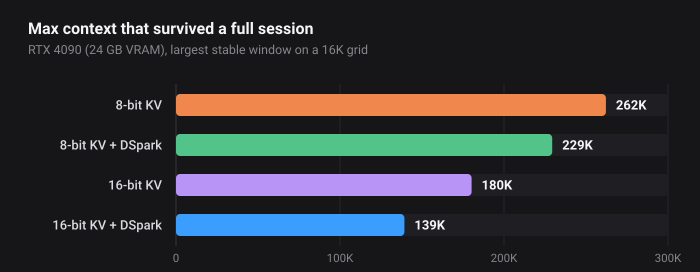
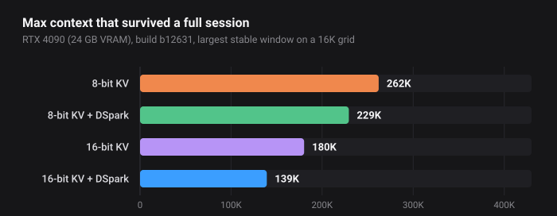
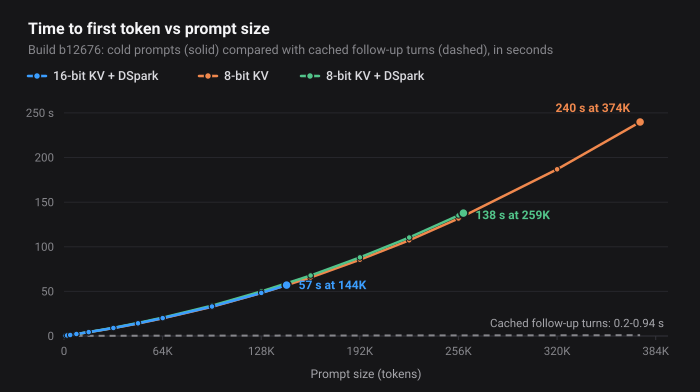
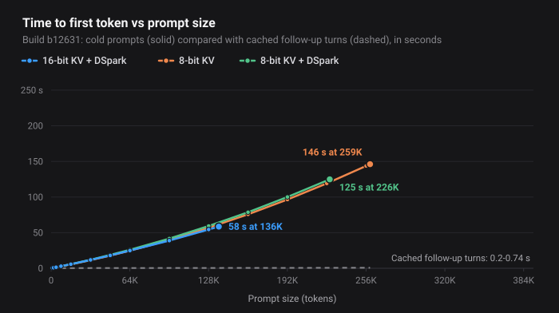
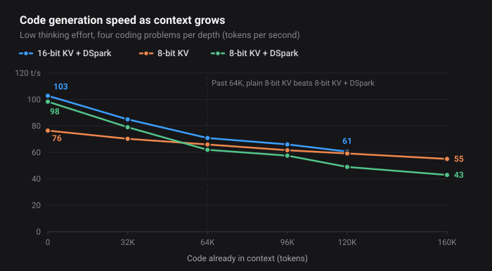
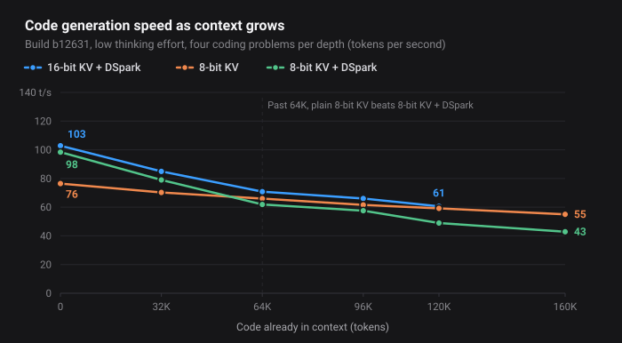

> **Update (25 Nov 2026):** I reran everything on Unsloth's `b12676-mix-c32dcc8` build and the main takeaway flipped: 8-bit KV + DSpark is now the fastest setup at every depth. Use the tabs on any chart below to switch between `b12676` and the original `b12631` run, and skip `b12649` on 24 GB (it used 1.5-2 GB more VRAM and OOMed at 262K).

Last week [Thinking Machines Lab](https://thinkingmachines.ai/) released [Inkling-2-Mini](https://huggingface.co/thinkingmachines/Inkling-2-Mini). Since its release it has been getting a lot of attention (rightly so!). Firstly, because it is the best model you can run on your local machine with as little as ~12 GB VRAM, sort of dethroning [Qwen3.8-27B](https://unsloth.ai/docs/models/qwen3.8) as the go-to local model. Secondly, because it is a sparse MoE model with 26.4B total parameters and 3.4B active (~5.4B effective active parameters per token to account for looping). Local inference is mostly memory-bandwidth bound, so only activating a small fraction of the weights per token gives you the best of both worlds: the capability of a ~26B model at the generation speed of a much smaller one.

I can genuinely say that it is the best local model since Qwen3.8 and honestly I can even go as far as saying that it feels on par with Claude Sonnet 5.5 to me.

In one of my earlier posts this year, I walked through [deploying a local model on a 24 GB GPU](https://aayushgarg.dev/posts/2026-03-29-local-llm-opencode/index.html) on my RTX 4090 workstation and using it from my Mac. I followed the same approach here, though I am using the [Unsloth desktop app](https://unsloth.ai/docs/desktop) instead of OpenCode. It is a great app for local LLM inference, very easy to set up and switch between models. I would highly recommend giving it a try. If you like, you can also hook it up to OpenCode like in my Qwen post, though I have not tried it there yet.

Inkling-2-Mini supports up to a 1M token context window but on a 24 GB card VRAM decides how much you actually get. Before settling on a daily setup for coding agents, I wanted to find the best context length and server settings for a 4090 with acceptable performance. This is a quick post walking through what I tested and the configs I ended up with.

## Benchmarking

When deploying a coding model on 24 GB of VRAM, three things decide whether it feels good to use:

- **Max usable context:** how much context fits in VRAM without running out of memory mid-session.
- **Time to first token (TTFT):** how long you wait for the model to read your prompt and start replying.
- **Generation speed (tok/s) at long context:** how fast it writes code as the session grows, especially once you pass 64K-100K tokens.

In llama.cpp there are a few flags you end up tuning to balance speed against context size:

- **KV cache precision (16-bit vs 8-bit):** By default llama.cpp uses a 16-bit KV cache. Switching to 8-bit (`--cache-type-k q8_0 --cache-type-v q8_0`) roughly cuts KV cache memory in half so you can fit a lot more context on the same card.
- **Speculative decoding (DSpark draft model):** If a model supports MTP or has a draft model available, you can use speculative decoding to speed up generation. For Inkling-2-Mini there is a tiny 0.4-0.5 GB DSpark draft model so I tested it here. It speeds up generation at every depth in exchange for some VRAM headroom.
- **Micro-batch size (`-ub`):** This controls how many prompt tokens hit the GPU at once during prefill. `-ub 2048` processes prompts ~20% faster than `-ub 512` (~4,730 vs ~3,940 tok/s on an 8K prompt) but cuts usable context sharply (262K down to 163K on 8-bit KV + DSpark), so `-ub 512` stays the better choice for long sessions.
- **Concurrent slots (`--parallel`):** Each slot splits your VRAM and throughput. Since I am running on a single 24 GB card and am the only person using this server, it is always best to set it to `--parallel 1`.

## Benchmark results

All numbers below are from single runs on my RTX 4090, using slices of real C++ source code (from the llama.cpp repo) to fill the context instead of synthetic dummy tokens.

### How much context fits on 24 GB

::: {.panel-tabset group="build"}

#### b12676 (latest)

{fig-alt="Horizontal bar chart comparing the largest context window that survived a full session on build b12676 across four setups: 376K for 8-bit KV, 262K for 8-bit KV with DSpark, 196K for 16-bit KV and 147K for 16-bit KV with DSpark."}

#### b12631 (original)

{fig-alt="Horizontal bar chart comparing the largest context window that survived a full session on build b12631 across four setups: 262K for 8-bit KV, 229K for 8-bit KV with DSpark, 180K for 16-bit KV and 139K for 16-bit KV with DSpark."}

:::

One catch if you download from Hugging Face today: Unsloth's re-uploaded 0.5 GB drafter (`dspark-Inkling-2-Mini-Q8_0.gguf`) matches the original 0.4 GB one on speed (`dspark-Inkling-2-Mini-Q8_0_Old.gguf`, plotted above) but uses ~0.7 GB more VRAM, bringing the DSpark limits down to 229K (8-bit KV) and 131K (16-bit KV). Single prompts can also still trick you: with the new drafter 8-bit KV + DSpark survived one 244K prompt, then crashed early in the multi-turn session.

> Switching to 8-bit KV nearly doubles usable context (196K to 376K), and even with DSpark enabled you still get 229K-262K tokens on 24 GB.

### Time to first token (TTFT)

::: {.panel-tabset group="build"}

#### b12676 (latest)

{fig-alt="Line chart of cold time to first token vs prompt size on build b12676 for three setups, reaching 57 s at 144K for 16-bit KV with DSpark, 138 s at 259K for 8-bit KV with DSpark and 240 s at 374K for 8-bit KV, plus a dashed line showing cached follow-up turns staying under 1 second."}

#### b12631 (original)

{fig-alt="Line chart of cold time to first token vs prompt size on build b12631 for three setups, reaching 58 s at 136K for 16-bit KV with DSpark, 125 s at 226K for 8-bit KV with DSpark and 146 s at 259K for 8-bit KV, plus a dashed line showing cached follow-up turns staying under 1 second."}

:::

All three setups track almost identically until each hits its VRAM ceiling. In a 12-turn tool calling session starting at 41K tokens, only the first cold turn felt slow (12.3 s, down from 15.8 s on `b12631`) while cached turns 2-12 finished in a median of 1.2-1.5 s.

> Cold TTFT depends almost entirely on prompt size, while cached follow-up turns stay under 1 s at every depth.

### Code generation speed as context grows

::: {.panel-tabset group="build"}

#### b12676 (latest)

{fig-alt="Line chart of code generation speed on build b12676 from 0 to 160K tokens of code in context across three setups, with 8-bit KV + DSpark leading from 119 tok/s at 0 down to 72 tok/s at 160K."}

#### b12631 (original)

{fig-alt="Line chart of code generation speed on build b12631 from 0 to 160K tokens of code in context across three setups, showing 8-bit KV + DSpark dropping behind plain 8-bit KV past 64K."}

:::

This is where `b12676` flips the story from `b12631`. Before, 8-bit KV + DSpark fell behind plain 8-bit KV past 64K. On `b12676` every setup is faster, and 8-bit KV + DSpark gained up to 67% at long context so it now leads at every depth up to 160K.

> On `b12676`, 8-bit KV + DSpark gives a ~34% boost on short prompts and stays the fastest setup all the way to 160K.

### Thinking effort and tool calls

A couple of smaller things came up while testing that still hold on `b12676`:

- **Keep `--reasoning-effort low` as the default:** In my tests, `low` kept replies snappy while still letting any client bump it up with `"reasoning_effort": "high"` when needed. Setting effort to `none` still made the model think and was slower than `low`, and `--reasoning-budget 0` broke tool calling pretty badly.
- **Switching effort mid-session clears the prompt cache once:** Changing thinking effort partway through a 40K token session made the server reread the whole history (11.9 s to first token on `b12676`, down from 15.2 s before).

## Possible configuration options

Putting all of that together on `b12676`, here is how the three configs compare on a 24 GB card:

| Config | Setup | Context | Speed at 0 / 64K / 120K / 160K (tok/s) | Peak VRAM |
|---|---|---|---|---|
| **Recommended** | 8-bit KV + DSpark | 196K | 119 / 98 / 82 / 72 | 21.9 GB |
| **Long context** | 8-bit KV | 262K | 89 / 75 / 67 / 62 | 21.5 GB |
| **16-bit KV + DSpark** | 16-bit KV + DSpark | 131K | 117 / 89 / 76 / n/a | 22.4 GB |

Peak VRAM for the DSpark rows uses the 0.4 GB drafter; the 0.5 GB drafter adds ~0.7 GB.

Honestly, on `b12676` the choice is much simpler:

- **Recommended (8-bit KV + DSpark, 196K)** is the clear daily setup. It is the fastest across every depth and fits comfortably with either drafter.
- **Long context (8-bit KV, 262K-376K)** is only needed if sessions regularly pass 229K-262K tokens, though cold prompts take ~132 s at 256K and ~240 s at 374K.
- **16-bit KV + DSpark (131K)** no longer has a speed case: it is equal or slower at every depth with a smaller window, and sits right on the VRAM limit with the 0.5 GB drafter.

### Running it with llama.cpp

Follow [Unsloth's Inkling-2-Mini guide](https://unsloth.ai/docs/models/inkling-2-mini) to download `UD-Q4_K_XL` (17.6 GB) and the `Q8_0` DSpark drafter, and grab release `b12676-mix-c32dcc8` or newer from their [llama.cpp releases](https://github.com/unslothai/llama.cpp/releases) instead of `b12649`.

Here is the **Recommended** config (8-bit KV + DSpark at 196K context):

```bash
BIN=~/llama.cpp-unsloth/b12676
MODELS=~/MODELS/unsloth/Inkling-2-Mini-GGUF
export LD_LIBRARY_PATH="$BIN:${LD_LIBRARY_PATH:-}"
$BIN/llama-server \
  -m $MODELS/Inkling-2-Mini-UD-Q4_K_XL.gguf \
  --model-draft $MODELS/dspark-Inkling-2-Mini-Q8_0.gguf \
  --spec-type draft-dspark --spec-draft-n-max 2 --n-gpu-layers-draft 99 \
  --cache-type-k q8_0 --cache-type-v q8_0 \
  -c 196608 -ub 512 -ngl 99 -fa on --parallel 1 --jinja \
  --reasoning-effort low \
  --temp 1.0 --top-p 1.0 --top-k 0 --min-p 0.0 \
  --alias inkling-2-mini \
  --host <YOUR_GPU_SERVER_IP> --port 8080 \
  --no-slots --no-webui
```

- For **more context with DSpark**, raise `-c` to `229376` (or `262144` with `dspark-Inkling-2-Mini-Q8_0_Old.gguf`).
- For **Long context (262K-376K)**, drop the `--model-draft` and `--spec-type` lines and set `-c` to `262144` (up to `376832`).

Even at 196K you only have 1.5-2 GB of VRAM free depending on the drafter, so try not to run anything else heavy on the GPU at the same time 🙈.
